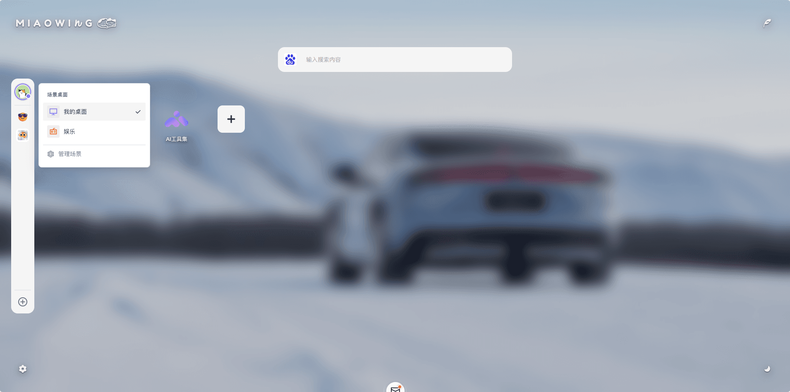
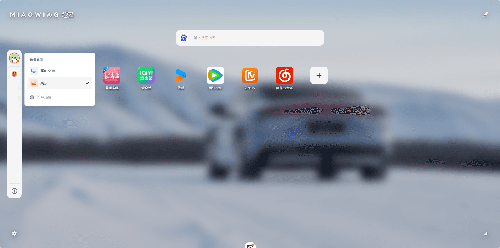
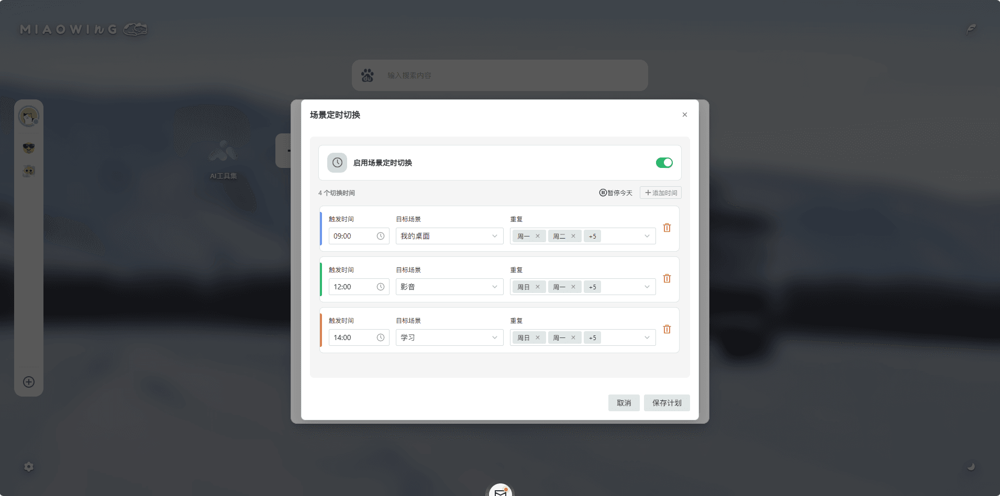
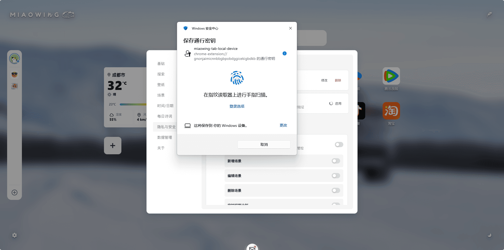
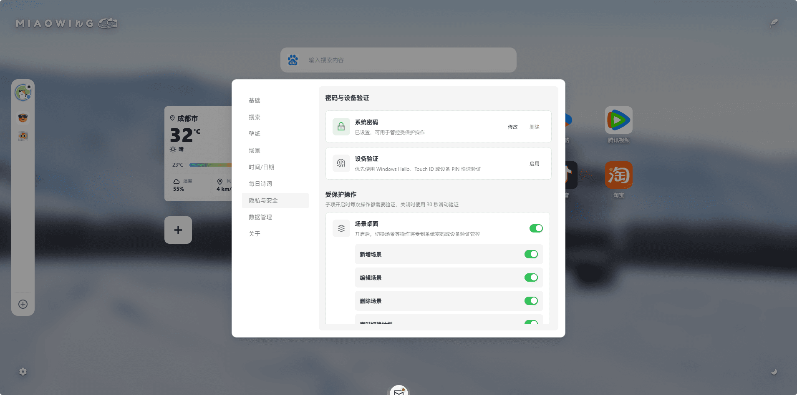
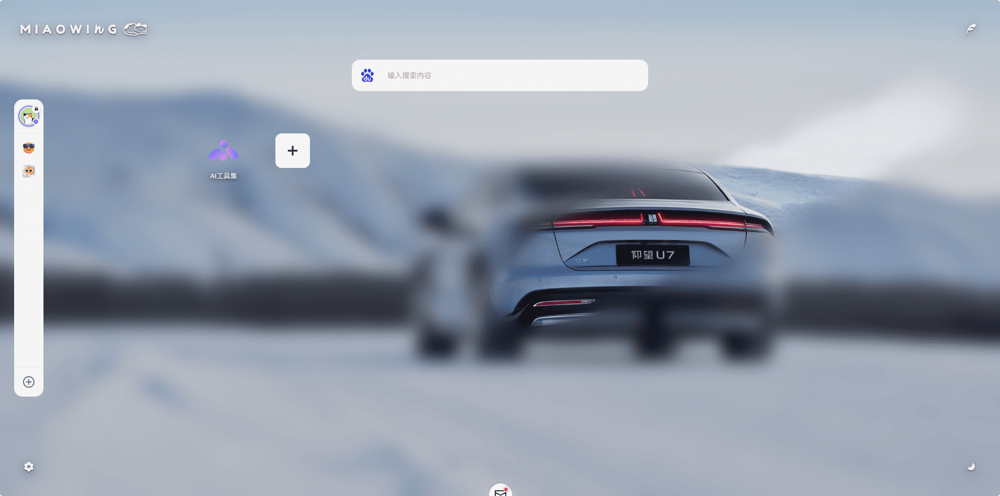

# 喵ing Tab 1.2.0 正式发布

## 场景

`场景` 是 `喵ing Tab 1.2.0` 最重磅的更新，它可以将您拥有的繁复的多个页面归类为一个又一个场景，您可以在不同场景之间进行切换。

除了手动切换，您还可以通过配套的 `定时切换` 功能，来规划一条时间轨迹，让您的场景在一天之内按时间进行自动切换，例如您可以设置在每天早上 `9:00` 切换到工作场景，在 `12:00` 切换到影音场景，在 `14:00` 切换到学习场景，在`18:00`切换到娱乐场景。

## 隐私与安全

如果仅仅是 `定时切换` ，那么 `场景` 功能就显得有些单薄，还谈不上重磅。

`喵ing Tab 1.2.0` 加入了系统层面的 `隐私与安全` 功能，这使得管理和验证数据和隐私操作成为了现实。

`隐私与安全` 功能完全类似于您的手机，它的基础同样是一个全局的6位数字密码，当您设置了系统密码之后就可以在受保护操作中打开需要保护的操作，如果您还没有设置系统密码而直接打开受保护的操作项，那么此时系统会弹出系统密码设置框，在设置完成后，系统密码会被应用，同时您打开的受保护操作项也会即刻生效。

如果您认为手动输入密码过于麻烦，那么当你的设备支持生物验证的时候，您还可以通过设置 `设备验证` 来使用您已经在个人终端上已经设置的生物验证，例如指纹识别、面部识别等。

## 受保护操作

目前支持的受保护操作包含场景桌面和数据恢复两项，其中场景桌面还包含四个子项，子项的开关状态可以单独设置，其含义为：打开子项开关，那么子项对应的操作每次触发都需要进行验证；关闭子项开关，子项的操作会共享系统全局的 `30s` 滑动验证，也就是说，任何一次触发系统验证的操作在你验证成功后，将会对关闭了开关的子项保留 `30s` 的免验证时间。

## 壁纸

在`壁纸`中新增了一些更有意思的背景加载动画，同时新增了 `鼠标擦除模糊` 功能，这项功能可以在你打开背景模糊时，短暂地使移动的鼠标周围变得清晰。

## 写在最后

希望您能喜欢 `喵ing Tab 1.2.0` 。

发布日期：2026-08-09
